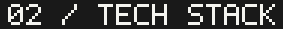
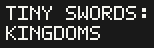
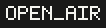
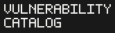

<!-- HEADER -->

<a href="https://github.com/Mr-friendly-Spy">
  
</a>

<div align="center">

  

  <br/><br/>

  <a href="https://vkplay.ru/play/game/tinyswords-kingdoms-49863/">
    
  </a>
  <a href="https://www.youtube.com/watch?v=rC5Em4xEyeA&amp;t=2494s">
    
  </a>
  <a href="https://github.com/Mr-friendly-Spy?tab=repositories">
    
  </a>
  

</div>

<!-- ABOUT -->

## 

> *I explore how software works under the hood, build games, and automate everyday tasks.*

```text
name:       Egorik
nickname:   Mr-friendly-Spy
focus:      Game Development · Software Development
languages:  C++ · C# · Python
building:   games · tools · REST APIs · chatbots
approach:   OOP · software design · hands-on development
```

I work with **Unity**, **Unreal Engine**, and **Godot**, create terrain in **Gaea**, and design mockups and UML diagrams in **Figma**. I have experience with **Linux**, **Docker** containers, **VirtualBox** virtual machines, and **VK Cloud** services. I use **Ghidra** to explore and analyze software.

<!-- STACK -->

## 

**`LANGUAGES`**


**`GAME DEVELOPMENT / ENVIRONMENTS`**


**`BACKEND / DATA`**


**`CONTAINERS / CLOUD / VIRTUALIZATION`**


**`DESIGN / ANALYSIS / DEVELOPMENT`**


<!-- EXPERIENCE -->

## 

| Area | Experience |
| :--- | :--- |
| **Game Development** | Unity, Unreal Engine, Godot, C#, and C++; developing games and publishing a game on VK Play |
| **Terrain & Design** | Terrain creation in Gaea; mockups and UML diagrams in Figma |
| **Software Design** | OOP, organizing code into classes and modules, and documenting application structure |
| **Tools & Automation** | Python utilities, document processing, web scraping, and contributions to a synthetic aerial imagery generator |
| **Chatbots & Services** | Contributions to Market Mate; REST APIs, FastAPI, and SQLite |
| **Infrastructure** | Linux, Docker and Docker Compose, VirtualBox, and VK Cloud services |
| **Software Analysis** | Using Ghidra to explore software internals |

<!-- ACHIEVEMENTS -->

## 

- **Published [Tiny Swords: Kingdoms](https://vkplay.ru/play/game/tinyswords-kingdoms-49863/) on VK Play.**
- **Contributed to team projects:** [open_air](https://github.com/EvgenieLebedev/open_air) for synthetic aerial imagery generation and the [Market Mate](https://github.com/Geeri45/Market_Mate) chatbot.
- **Built practical tools:** office automation utilities, a web scraper, a threat information exchange service, and a vulnerability catalog.

<!-- PROJECTS -->

## 

| Project | What It Does | Stack / Focus |
| :--- | :--- | :--- |
| [](https://vkplay.ru/play/game/tinyswords-kingdoms-49863/) | My game, published on VK Play | `Game Development` |
| [](https://github.com/EvgenieLebedev/open_air) | Team project: generates synthetic aerial imagery from 3D tiles, with GPS EXIF metadata and trajectory exports | `Python` · `Flask` · `CesiumJS` |
| [](https://github.com/Geeri45/Market_Mate) | Team project: contributed to chatbot development | `Chatbots` |
| [](https://github.com/Mr-friendly-Spy/ThreatExchange) | REST service for exchanging threat information by MD5, with Docker deployment | `Python` · `FastAPI` · `SQLite` · `Docker` |
| [](https://github.com/Mr-friendly-Spy/Office_Tweaks) | CLI utility for PDF/DOCX conversion, image compression, and file management | `Python` · `CLI` |
| [](https://github.com/Mr-friendly-Spy/vulnerability-catalog) | Imports JSON feeds into SQLite and checks product versions against a vulnerability catalog | `Python` · `SQLite` · `SQL` |
| [](https://github.com/Mr-friendly-Spy/The_Parser_) | Scrapes information about car service centers in Moscow and exports it to CSV | `Python` · `Parsing` |
| [](https://github.com/Mr-friendly-Spy/wheel-of-fortune-game) | Console word-guessing game with difficulty levels, statistics, and saved high scores | `Python` · `OOP` |

<!-- STATS -->

## 

<div align="center">

  
  

  <br/><br/>

  

  <br/><br/>

  


</div>

<!-- FOOTER -->

<br/>



